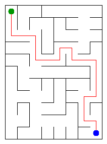

# Assignment 3. Maze Escape

Student ID: 251419
Name: TODO
Group: TODO
Maze size (rows x columns): 11 x 8

This file is the report. Fill it in as you go. How to start: `START_HERE.md`. The task: `docs/Assignment3.pdf`.

## Program output

The 13 lines your program prints on your data (`java -cp out Main`):

    Broken: 87
    Kept: 70
    Last broken wall: 139
    MST cost: 28117
    Heaviest broken wall: 971
    Path length: 21
    DFS visited: 47
    Dead ends: 27
    Zones: 9
    Largest zone: 16
    Is DAG: 0
    Flow stages: 6
    Fastest route cost: 16

My maze:

## Questions

Mission 0. What do find and union do, and what makes them fast in your code?

`find(x)` walks from x up the parent links to the root, the representative of the set; `union(a, b)` finds both roots and, if they differ, hangs one root under the other and returns true. Two tricks keep the trees flat: union by size (the smaller tree goes under the larger one, so the height is at most log n) and path compression (after `find` every cell on the way points straight to the root). Together they give amortized O(α(n)) per operation, which is practically a constant. `find` is written with two loops, not recursion, so even a chain of 1 000 000 cells cannot overflow the stack.

Mission 1. Why is Broken always R*C - 1, and Kept always (R-1)*(C-1)?

A wall is broken only when it joins two different sets, so every broken wall reduces the number of sets by exactly one and never makes a cycle. We start with R*C sets and the grid is connected, so at the end there is one set: R*C - 1 walls were broken, the result is a spanning tree. The grid has R*(C-1) + C*(R-1) = 2RC - R - C inner walls, so Kept = 2RC - R - C - (RC - 1) = RC - R - C + 1 = (R-1)*(C-1).

Mission 2. My MST cost from Kruskal and from Prim, and why they are equal:

Kruskal: 28117, Prim: 28117 (the program prints no warning, so they are equal). Check on my maze: 11 * 8 - 1 = 87 broken, (11-1) * (8-1) = 70 kept. Both algorithms build a minimum spanning tree: Kruskal adds the cheapest wall that joins two different sets, Prim adds the cheapest wall that leaves the current tree, and both choices are safe by the cut property. All costs are different, so the minimum spanning tree is unique, and both algorithms find the same tree, so the costs are equal.

Mission 3. Why is there exactly one path between two cells? How did you avoid a stack overflow on a huge maze?

The maze of Mission 1 is a tree: it is connected and has n - 1 edges, so it has no cycle. If there were two different paths between two cells, together they would contain a cycle, so the path is unique, and DFS finds exactly this path. I do not use recursion: the DFS keeps its own `int[]` stack with the current way from the start and an array `dir[cell]` with the next direction (up, right, down, left) to try, so the depth of the Java call stack does not depend on the maze size. I checked it on a 1000 x 1000 maze (the path there is thousands of cells long).

Mission 4. Why does the second pass of Kosaraju go on the reversed graph? Why do the slides have no cycle exactly when Zones equals the number of cells?

After the first pass the cell finished last lies in a "source" zone: no slide comes into this zone from a zone that is not finished yet. In the reversed graph we can leave this zone only towards zones that already have a number, so the DFS from it reaches exactly the cells of its own zone, and nothing else. On the original graph the DFS would run out of the zone into all zones reachable from it. If there is a cycle, all its cells are in one zone, so there are fewer zones than cells; if there is no cycle, no two cells can reach each other, so every cell is a zone of its own and Zones = n.

Mission 5. Why is it enough to go through the zones in the order of their numbers? What does this pass cost?

Kosaraju numbers the zones in a topological order: every slide between two zones goes from a smaller number to a larger one, and the zone graph has no cycle. So when we come to zone x, all zones with an edge into x were already processed, and the longest chain and the cheapest route to x are final; we only push them forward along the edges of x (dynamic programming on a DAG, no priority queue needed). Every zone and every slide is looked at once, so the pass costs O(n + m) time and O(n + m) memory.

## AI use

TODO: write honestly which AI tool you used and for what (for example: "Claude (Anthropic): helped write and explain the code of the missions and the answers in this README; I read every line, ran the checks and can explain it myself").

## Timing (Mission 7)

Milliseconds, 5 runs each, from `java -cp out Bench`.

| maze | Kruskal | Prim |
|---|---|---|
| 100 x 100 | 25 12 19 33 30, avg 24 | 34 11 17 11 16, avg 18 |
| 300 x 300 | 170 172 151 122 184, avg 160 | 143 127 164 360 252, avg 209 |
| 1000 x 1000 | 1907 2129 1877 1980 1927, avg 1964 | 3944 3646 3889 3791 3887, avg 3832 |

From 300 x 300 to 1000 x 1000 the number of walls grows about 11 times, and Kruskal grows about 12 times, Prim about 18 times: a bit faster than linear, as O(m log m) predicts, plus extra cost of cache misses and garbage collection on big arrays. Prim is slower than Kruskal on big mazes because its priority queue holds boxed `Integer` objects and makes many inserts, while Kruskal sorts once. On 100 x 100 the times are only milliseconds and are noisy (JIT warm-up), so they say little.

## Complexity

n is the number of cells, m the number of walls (or slides). Fill in every algorithm you wrote.

| algorithm | time | space | assumptions |
|---|---|---|---|
| DSU find and union | O(α(n)) amortized, O(log n) worst case | O(n) | union by size + path compression |
| Kruskal | O(m log m) | O(n + m) | sorting dominates; m DSU operations are O(m α(n)) |
| Prim | O(m log m) | O(n + m) | lazy version, binary heap (PriorityQueue) holds up to m walls |
| DFS | O(n + m) | O(n) | own stack, no recursion; in the tree maze m = n - 1, each cell checks 4 directions |
| Kosaraju | O(n + m) | O(n + m) | two iterative DFS passes, adjacency lists from Graphs |
| Route in the zone graph | O(n + m) | O(n + m) | zones are already in topological order, no priority queue |

## Before you submit

- data/walls.txt, data/slides.txt and output/maze.png are in the repository.
- `java tools/Check.java` shows all examples right.
- This README is filled in, the program output and the section AI use included.
- The work is pushed to main (at least one commit per mission) and the repository is public.
- The link is attached in Moodle.
